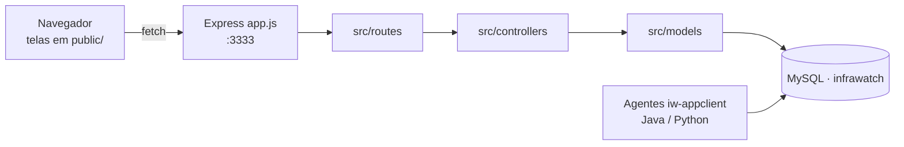

# InfraWatch - Monitoramento de Hardware de FDPSs

Aplicação web do projeto **InfraWatch**: serve o frontend e expõe a API (nomeada
internamente `web-data-viz`) que lê os dados de monitoramento gravados no banco
MySQL pelos agentes instalados nas máquinas monitoradas.

## Visão do projeto

- **Objetivo:** dar visibilidade sobre o estado de hardware das máquinas de uma
  empresa (CPU, memória RAM, disco, rede e sistema), concentrando as leituras em
  dashboards por máquina e uma visão geral com alertas.
- **Escopo:** este repositório é a camada web do sistema. Ele **não** coleta
  métricas nem administra infraestrutura — apenas lê o banco e entrega as telas e
  os endpoints de consulta. A coleta e a infraestrutura ficam nos repositórios
  irmãos.

### Onde se encaixa no sistema InfraWatch

| Repositório | Papel |
|---|---|
| [`iw-infra`](https://github.com/Infra-Watch/iw-infra) | Provisionamento (AWS EC2, Docker Compose) do banco e do site. |
| [`iw-database`](https://github.com/Infra-Watch/iw-database) | Schema MySQL (`infrawatch`) consumido por esta aplicação. |
| [`iw-appclient-java`](https://github.com/Infra-Watch/iw-appclient-java) | Agente Java que coleta métricas na máquina monitorada. |
| [`iw-appclient-python`](https://github.com/Infra-Watch/iw-appclient-python) | Agente Python que coleta métricas na máquina monitorada. |
| **`iw-appweb`** (este repo) | Frontend + API de consulta dos dados. |

Os agentes gravam as leituras no banco `infrawatch`; esta aplicação lê esse mesmo
banco e apresenta os dados. No `.env.dev` deste repositório a aplicação usa a
porta `3333` (`APP_PORT`) e o MySQL a `3306` (`DB_PORT`).

## Funcionalidades

### Telas (frontend em `public/`)

- Página inicial / institucional (`index.html`)
- Login (`login.html`) e cadastro de usuário (`cadastro.html`)
- Cadastro de empresa (`html_colaborador_infrawatch/cadastro_empresa.html`)
- Reativação de chave de acesso (`reativar_chave.html`)
- Dashboard geral (`dashboard_geral.html`) e dashboard detalhada
  (`dashboard_detalhada.html`)
- Dashboards por componente em `public/dashboards/`: `cpu`, `ram`, `disco`,
  `rede` e `sistema`
- Área administrativa em `html_user_perfil_adm/`: gerenciamento de acesso
  (`gerenciamento_acesso.html`) e gerenciamento de máquina
  (`gerenciamento_maquina.html`)
- Estilos de perfil de usuário em `css/perfil.css` (não há `perfil.html`
  dedicado em `public/`)

### API (rotas em `src/routes/`)

Montadas em `app.js`. Os parâmetros entre `:` são parâmetros de rota.

| Recurso | Método e caminho |
|---|---|
| Index | `GET /` |
| Usuários | `POST /usuarios/cadastrar`, `POST /usuarios/autenticar`, `GET /usuarios/buscarPorId/:idUsuario/:idEmpresa`, `GET /usuarios/buscarPorEmpresaECategoria/:idEmpresa/:idCategoria`, `PUT /usuarios/atualizarNome`, `PUT /usuarios/atualizarEmail`, `PUT /usuarios/atualizarSenha`, `PUT /usuarios/atualizarCategoriaAcesso`, `DELETE /usuarios/remover/:id` |
| Empresas | `POST /empresas/cadastrar`, `GET /empresas/buscarTodas`, `GET /empresas/buscar/:idEmpresa`, `PUT /empresas/atualizar`, `DELETE /empresas/remover/:idEmpresa` |
| Máquinas | `POST /maquinas/cadastrar`, `GET /maquinas/buscarPorEmpresa/:idEmpresa`, `GET /maquinas/buscarKpisGeral/:idEmpresa/:intervalo`, `GET /maquinas/buscarPorMaquina/:idEmpresa/:idMaquina`, `PUT /maquinas/atualizar`, `DELETE /maquinas/remover/:idEmpresa/:idMaquina` |
| Componentes | `GET /componentes/buscarPorMaquina/:idEmpresa/:idMaquina/:intervalo` |
| Alertas | `GET /alertas/buscarPorEmpresa/:idEmpresa/:intervalo` |
| Acessos | `POST /acessos/cadastrar`, `GET /acessos/buscarPorEmpresa/:idEmpresa`, `PUT /acessos/atualizar`, `DELETE /acessos/remover/:idEmpresa/:idCategoria` |
| CPU | `GET /cpu/kpis/:idEmpresa/:idMaquina`, `GET /cpu/buscarPorEmpresa/:idEmpresa`, `GET /cpu/buscarGraficos/:idEmpresa/:idMaquina` |
| Disco | `GET /disco/kpis/:idEmpresa/:idMaquina`, `GET /disco/grafico_alertas/:idEmpresa/:idMaquina`, `GET /disco/grafico_leitura/:idEmpresa/:idMaquina`, `GET /disco/alertas/:idEmpresa/:idMaquina` |
| RAM | `GET /ram/kpis/:idEmpresa/:idMaquina`, `GET /ram/componentes/:idEmpresa/:idMaquina/:intervalo`, `GET /ram/historico-porcentagem/:idEmpresa/:idMaquina/:dias`, `GET /ram/historico-gb/:idEmpresa/:idMaquina/:dias`, `GET /ram/previsao-uso-ram/:idEmpresa/:idMaquina/:dias` |
| Rede | `GET /rede/buscarPorMaquina/:idEmpresa/:idMaquina`, `GET /rede/buscarTodas/:idEmpresa` |
| Sistema | `GET /sistema/kpis/:idEmpresa/:idMaquina`, `GET /sistema/leituras/:idEmpresa/:idMaquina`, `GET /sistema/componentes/:idEmpresa/:idMaquina/:intervalo` |

## Stack

- **Node.js** com **Express** `^4.17.1`
- **MySQL** via `mysql2` `^3.9.4` (banco `infrawatch`)
- **CORS** `^2.8.5`
- **dotenv** `^16.6.1` (carga das variáveis de ambiente)
- **path** `^0.12.7`
- **nodemon** `^2.0.7` (desenvolvimento)
- Frontend em HTML, CSS e JavaScript (sem framework), servido como estático a
  partir de `public/`

Scripts do `package.json`: `start` (`node app.js`) e `dev`
(`nodemon --exec node app.js`).

## Arquitetura

A API segue o padrão rota → controller → model, com a execução de SQL
centralizada em `src/database/config.js` (função `executar`, que abre uma conexão
MySQL por consulta). O frontend estático consome os endpoints acima.



## Estrutura de pastas (resumo)

```text
.
├── app.js                 # inicialização do Express, carga do .env e registro das rotas
├── init.sh                # script interativo que gera o .env e sobe a aplicação
├── package.json
├── .env.dev               # config de desenvolvimento
├── public/                # frontend (HTML, CSS, JS, imagens)
│   ├── css/
│   ├── js/
│   ├── assets/            # imagens e ícones (public/assets/imagens, logos)
│   ├── dashboards/        # dashboards por componente: cpu, ram, disco, rede, sistema
│   ├── html_colaborador_infrawatch/
│   └── html_user_perfil_adm/
└── src/
    ├── routes/            # definição dos endpoints HTTP
    ├── controllers/       # orquestração por recurso
    ├── models/            # acesso a dados (SQL)
    └── database/
        └── config.js      # conexão e execução das consultas MySQL
```

## Configuração (variáveis de ambiente)

`app.js` escolhe o arquivo de ambiente pela constante `ambiente_processo`: em
`producao` carrega `.env`, caso contrário `.env.dev`. As variáveis lidas pelo
código (`app.js` e `src/database/config.js`) são:

| Variável | Uso |
|---|---|
| `AMBIENTE_PROCESSO` | `producao` ou `desenvolvimento`; exigido por `src/database/config.js` |
| `DB_HOST` | host do MySQL |
| `DB_DATABASE` | nome do banco (ex.: `infrawatch`) |
| `DB_USER` | usuário do MySQL |
| `DB_PASSWORD` | senha do MySQL |
| `DB_PORT` | porta do MySQL (ex.: `3306`) |
| `APP_PORT` | porta da aplicação (ex.: `3333`) |
| `APP_HOST` | host da aplicação (ex.: `localhost`) |

## Como rodar

### Localmente

Pré-requisitos: Node.js e um MySQL acessível com o schema `infrawatch`.

Opção A — script interativo (gera o `.env`, instala dependências e sobe):

```bash
./init.sh
```

Opção B — manual:

```bash
npm install
# crie o .env (produção) ou use o .env.dev existente e ajuste os valores
npm start      # produção: node app.js
# ou, em desenvolvimento com reload automático:
npm run dev
```

Com o servidor no ar, acesse `http://<APP_HOST>:<APP_PORT>` (por padrão
`http://localhost:3333`).

### Via Docker

Este repositório não contém Dockerfile próprio. A imagem do site é construída e
orquestrada pelo repositório [`iw-infra`](https://github.com/Infra-Watch/iw-infra)
(`Dockerfile.site` + `docker-compose.yml`), que clona este projeto e instala as
dependências. Para subir banco e site juntos, siga o `iw-infra`.

## Testes

Não há suíte de testes automatizados neste repositório.
